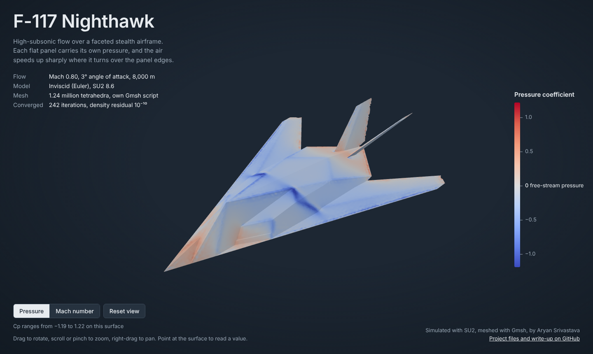
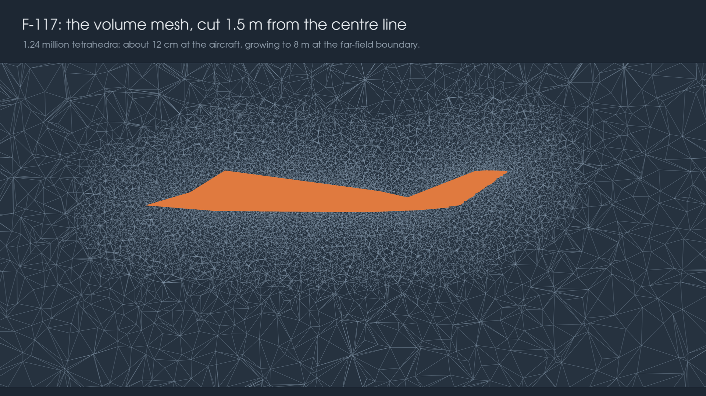
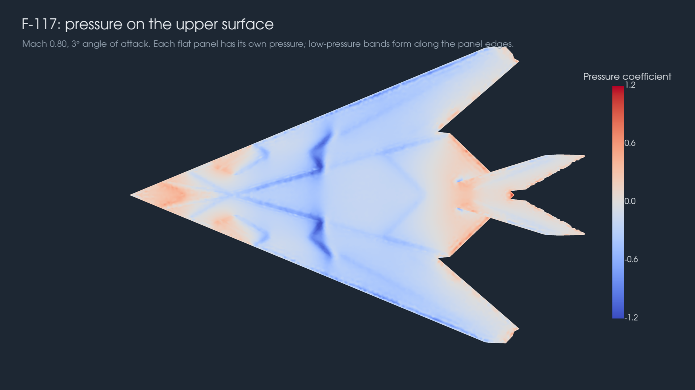
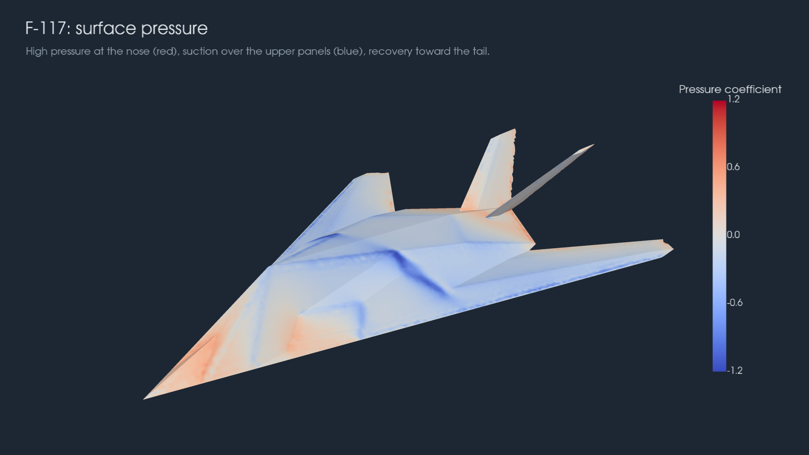
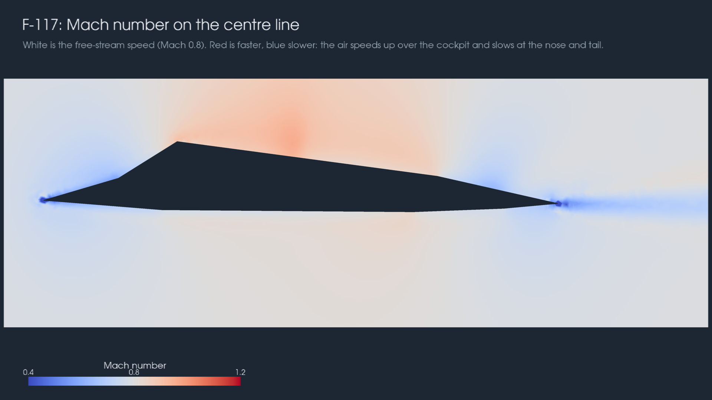
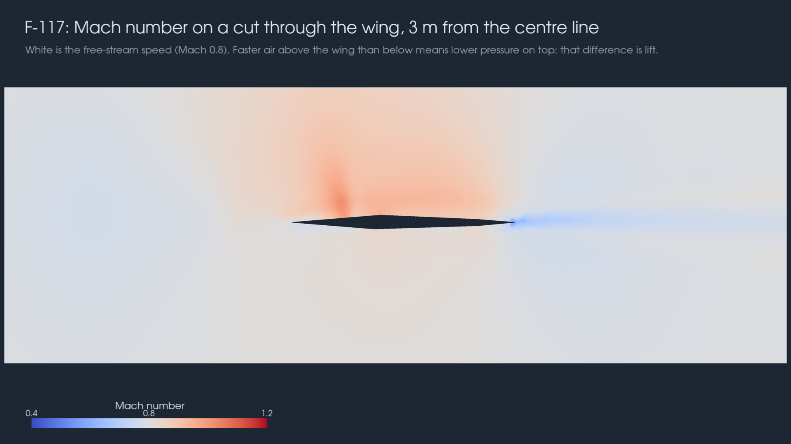
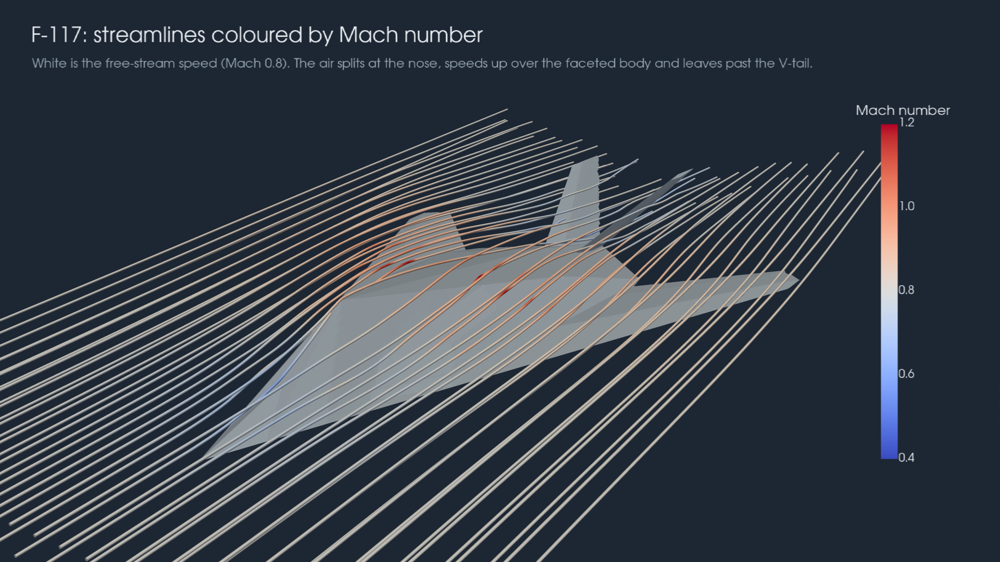
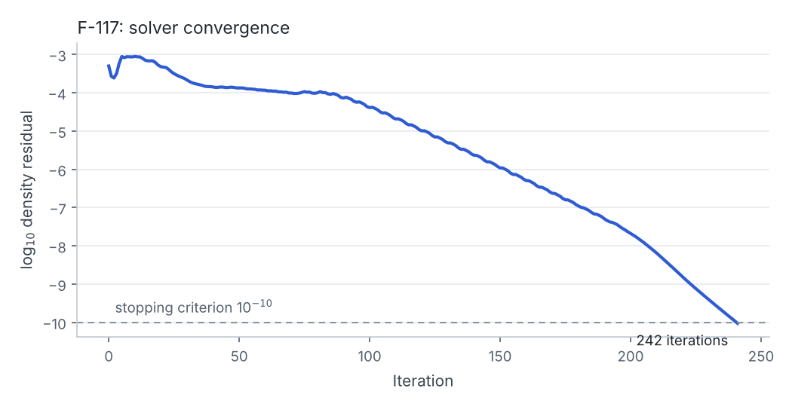

# F-117 Nighthawk: high-subsonic CFD from a hobby CAD model

Inviscid (Euler) simulation of the full F-117 Nighthawk airframe at Mach 0.80, using a public STL model that I repaired, meshed with a scripted Gmsh workflow, and solved with [SU2](https://su2code.github.io).

**[Explore the result in 3D in your browser](https://aryan-1512.github.io/F117-nighthawk-cfd/)**: rotate the aircraft, switch between pressure and Mach number, and read values directly off the surface.

**[Watch the air flow around the aircraft](https://aryan-1512.github.io/F117-nighthawk-cfd/flow.html)**: animated streamlines that move at the speed the simulation computed.

[](https://aryan-1512.github.io/F117-nighthawk-cfd/)

## What this project covers

My [ONERA M6 study](https://github.com/Aryan-1512/Onera-m6-su2) used a ready-made mesh. This one starts from a raw CAD download, so most of the work is turning a visual model into geometry a solver can use:

1. **Geometry repair.** The STL was made of 79 separate pieces, with six open holes, duplicate faces along the centre line and sliver triangles. I kept the body and tail fins, capped the intake and exhaust openings, joined the fins to the body, and rebuilt the surface into evenly sized triangles while keeping the sharp panel edges. ([`prep_scripts/`](prep_scripts))
2. **Meshing.** A commented Gmsh script builds the far-field box, splits the surface into named boundaries and grades the cell size from 12 cm at the aircraft to 8 m at the far field. ([`case/f117_full_mesh.geo`](case/f117_full_mesh.geo))
3. **Simulation and post-processing** in SU2 and ParaView.



## Setup

| | |
|---|---|
| Solver | SU2 8.6, compressible Euler equations (inviscid) |
| Flow | Mach 0.80, angle of attack 3°, standard atmosphere at 8,000 m (35.7 kPa, 236 K) |
| Geometry | full aircraft, 20.1 m long, 13.1 m span |
| Mesh | 1.24 million tetrahedra, no ill-shaped cells after optimisation |
| Domain | 160 m x 120 m x 120 m far-field box |
| Convergence | density residual reduced to 10⁻¹⁰ in 242 iterations |

## Results

The surface pressure shows the faceted design clearly. Each flat panel carries an almost uniform pressure, and the changes happen at the panel edges: wherever the air has to turn over a convex ridge, it accelerates and a narrow band of low pressure forms right along the edge. The nose is a stagnation region (Cp > 0), the upper panels are in suction, and the pressure recovers toward the trailing edges and tail. On the surface the flow stays below the speed of sound except in small pockets along the sharpest ridges.











<!-- Animation placeholder:  -->



## Modelling assumptions

- **Inviscid flow.** No boundary layer, friction drag or flow separation. Shock positions and pressure patterns are representative; drag is not.
- **Closed intakes and exhausts.** The engine openings are capped, so the flow around them is not physical. SU2's engine inflow and exhaust boundary conditions would be the next refinement.
- **Approximate geometry.** The model is a hobby reconstruction, and the repair changed the shape by a few centimetres (each tail fin was lowered 5 cm to join the body cleanly). There is no public reference data for this aircraft, so the results are illustrative. The method itself is checked on the ONERA M6 case.

## Reproducing the run

1. Install [SU2](https://su2code.github.io/download), [Gmsh](https://gmsh.info) and [ParaView](https://www.paraview.org/download/).
2. Download the original model from [GrabCAD](https://grabcad.com/library/f117-nighthawk-2) and run the three scripts in [`prep_scripts/`](prep_scripts/README.md). Copy the resulting `f117_full_domain.stl` into `case/`.
3. Open `case/f117_full_mesh.geo` in Gmsh, run **Mesh > 3D**, and export it as `case/f117_full.su2` in SU2 format.
4. In `case/`, run `SU2_CFD -t 4 inv_F117_full.cfg`.
5. Open `surface_flow.vtu` and `flow.vtu` in ParaView.

## Repository layout

```
case/          Gmsh meshing script and SU2 configuration
prep_scripts/  geometry repair pipeline
results/       convergence history and plot
images/        figures used in this README
docs/          the interactive viewer and flow animation (published with GitHub Pages)
tools/         scripts that convert SU2 output for the two web pages
```

## Development note

I set up and ran the simulations in SU2, generated and checked the meshes in Gmsh, analysed the results in ParaView and made the modelling decisions. The supporting scripts (geometry repair, the Gmsh meshing script, figure rendering and data export) and the web viewers were developed with AI assistance (Claude).

## Credits

Original 3D model: [F-117 Nighthawk on GrabCAD](https://grabcad.com/library/f117-nighthawk-2), used for non-commercial study with credit to its creator. The model files themselves are not redistributed here; the scripts in `prep_scripts/` rebuild the simulation geometry from the original download. The web viewer uses [three.js](https://threejs.org) (MIT licence).
